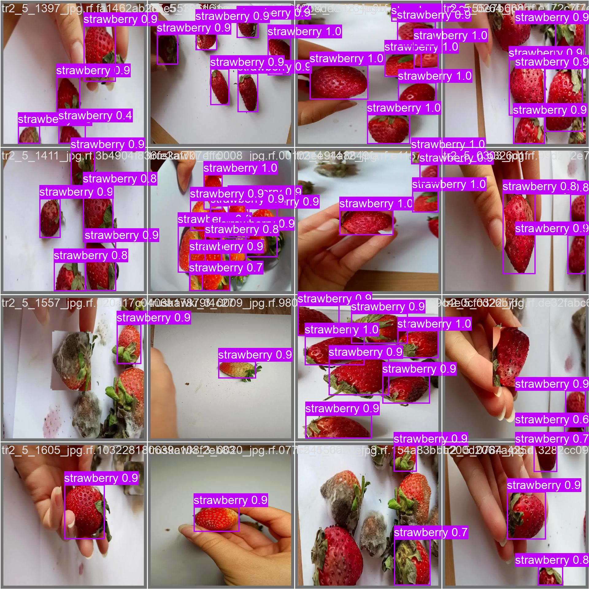
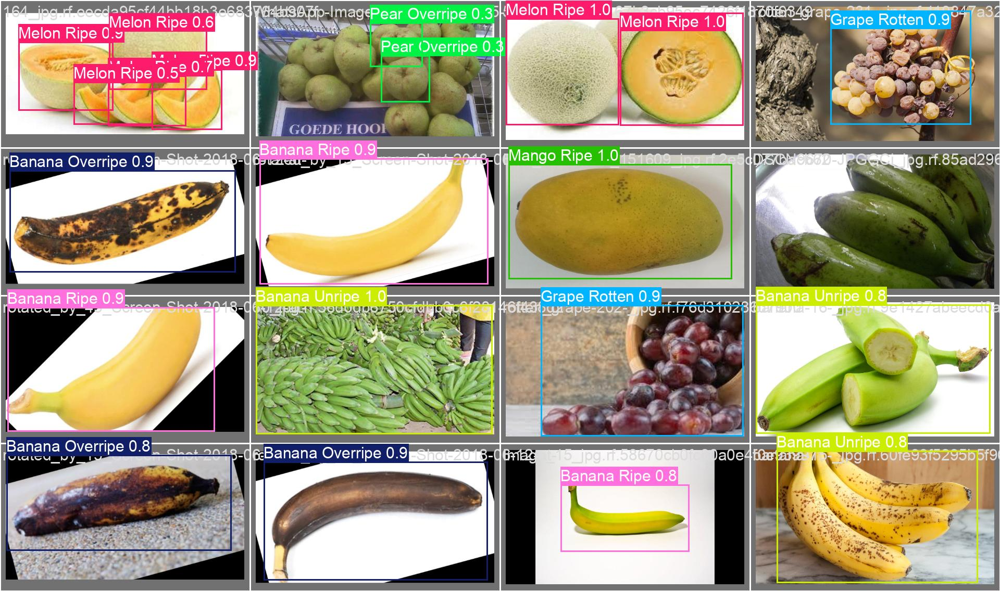
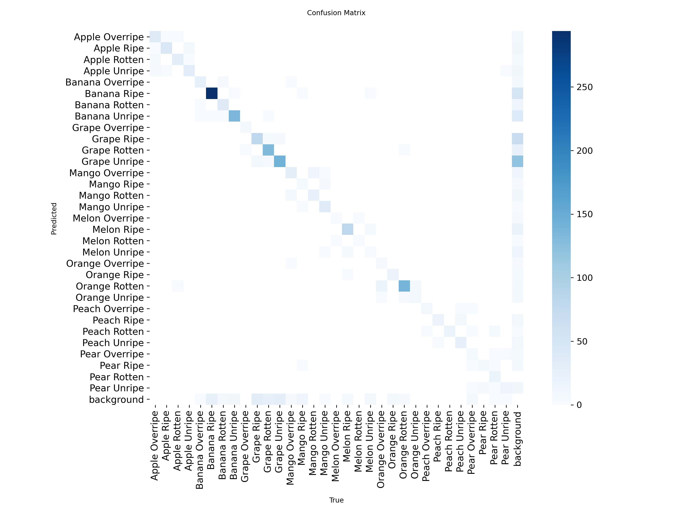
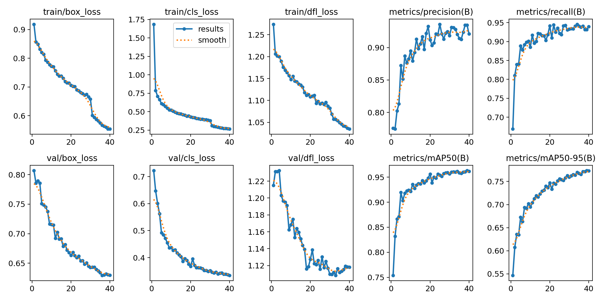
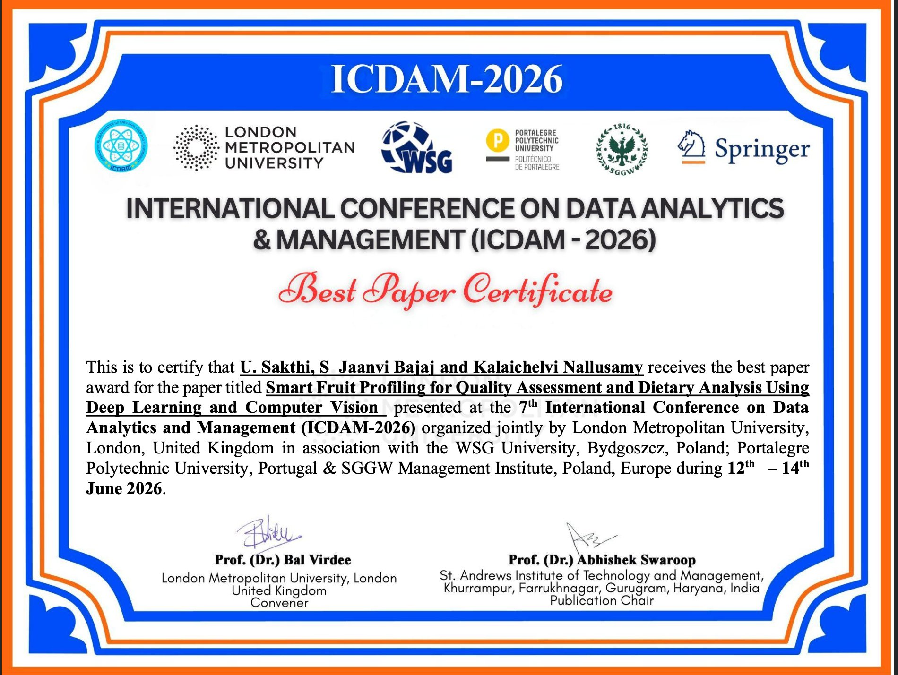

# Smart Fruit Profiling

**Fruit detection, ripeness grading and dietary info from a single photo — built with YOLOv9.**

🏆 **Best Paper Award, ICDAM 2026** (7th International Conference on Data Analytics and Management, London Metropolitan University, 12–14 June 2026). Accepted for publication in Springer *Lecture Notes in Networks and Systems*.

▶️ **[Watch the demo and see the award on LinkedIn](https://www.linkedin.com/posts/jaanvi-bajaj_deeplearning-computervision-machinelearning-ugcPost-7475468275326431232-tR7e/)**

---

## What it does

Point a camera at fruit, or upload a photo. The system:

1. **Detects** each fruit or vegetable and draws a box around it (32 classes).
2. **Grades ripeness** as unripe, ripe, overripe or rotten (8 fruits × 4 stages).
3. **Shows dietary info** — calories per 100 g, typical weight, and a short description.
4. **Gives advice** — estimated shelf life, how to use it, and a spoilage warning.

It runs as a Flask web app with image upload and live webcam modes.

## Results

Both models are YOLOv9-s, fine-tuned for 40 epochs at 650 px. Scores are on the validation split, final epoch.

| Model | Classes | Precision | Recall | mAP@50 | mAP@50-95 |
|---|---|---|---|---|---|
| Fruit & vegetable detection | 32 | 0.921 | 0.940 | 0.962 | 0.773 |
| Ripeness classification | 32 | 0.724 | 0.769 | 0.782 | 0.625 |

Ripeness is the harder task. Neighbouring stages (ripe vs. overripe) look alike, and that is where most errors fall — see the confusion matrix below.

| Detection on validation images | Ripeness on validation images |
|---|---|
|  |  |

| Ripeness confusion matrix | Detection training curves |
|---|---|
|  |  |

Full training logs and settings are in [`results/`](results/).

## How it works

```
Image / webcam frame
        │
        ├──► YOLOv9-s (fruits_and_vegetable.pt) ──► class ──► calorie + weight lookup
        │
        └──► YOLOv9-s (Fruits_rippen_detection.pt) ──► fruit + stage ──► shelf life,
                                                                       advice, warning
```

Dietary values come from a fixed lookup table per class (`FRUIT_VEG_INFO` in `app.py`). They are typical values, not measured from the image.

## Repository layout

```
app.py                       Flask app: login, upload and live routes
live.py / live1.py           Webcam detection (fruit type / ripeness)
fruits_and_vegetable.pt      Trained detection weights
Fruits_rippen_detection.pt   Trained ripeness weights
db.sql                       MySQL schema for user accounts
templates/  static/          Web pages and assets
notebooks/                   Training notebooks (run on Kaggle)
results/                     Metrics, curves and sample predictions
```

## Run it locally

**Needs:** Python 3.12, MySQL, a webcam for live mode.

```bash
git clone https://github.com/jaanvi-bajaj/Smart-Fruit-Profiling-Using-Deep-Learning-and-Computer-Vision.git
cd Smart-Fruit-Profiling-Using-Deep-Learning-and-Computer-Vision

python -m venv .venv && source .venv/bin/activate
pip install -r requirements.txt

mysql -u root -p < db.sql          # creates the `fruits` database

export DB_USER=root DB_PASSWORD=your_mysql_password
python app.py
```

Open http://127.0.0.1:5000, register, log in, and pick a mode.

Live mode opens a separate OpenCV window on the machine running the app. Press `q` to close it.

## Retrain the models

The notebooks in `notebooks/` download data from Roboflow and train with Ultralytics. Set your own key first:

```bash
export ROBOFLOW_API_KEY=your_key
```

Datasets (Roboflow Universe — check each page for its licence):
- Fruit & vegetable detection: `ml-datatrain / 572_fruits_vegetables`, v1
- Fruit ripeness: `fruitectives-team / fruit-ripeness-unjex`, v2

## Limitations

- Calories are per-class averages. Portion size is not estimated.
- Ripeness covers 8 fruits only: apple, banana, grape, mango, melon, orange, peach, pear.
- Shelf-life advice is rule-based on the predicted stage, not learned.
- Built as a research prototype, not a production service.

## Citation

> U. Sakthi, J. Bajaj, K. Nallusamy. "Smart Fruit Profiling for Quality Assessment and Dietary Analysis Using Deep Learning and Computer Vision." *ICDAM 2026*, Lecture Notes in Networks and Systems, Springer (in press).

## Authors

- **Jaanvi Bajaj** — SRM Institute of Science and Technology
- Dr. U. Sakthi
- Dr. Kalaichelvi Nallusamy

## Award

<a href="https://www.linkedin.com/posts/jaanvi-bajaj_deeplearning-computervision-machinelearning-ugcPost-7475468275326431232-tR7e/"></a>

Click the certificate to see the LinkedIn post with the demo video.

## License

MIT — see [LICENSE](LICENSE).
